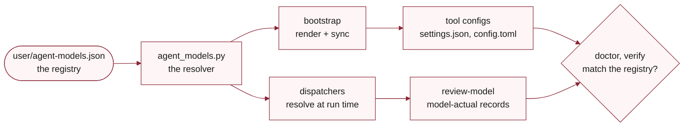

# agent-models

Show, check, and change the model and effort every agent role runs on. One file, the registry (`user/agent-models.json`), names them. One script, the resolver (`scripts/agent_models.py`), reads it. No other file in a source repository or a consumer names a concrete model or effort level, so this page states the rules and leaves the values to the registry: run `agent_models.py show` in your checkout to see them.

The skill is the way to answer "which model does this run on" without guessing, to change a row in one place, and to confirm that a change took effect. A config file that holds the right value proves nothing when another setting outranks it, so the skill checks at three levels: the configs against the registry (`doctor`), what each CLI reports it ran on (`verify`), and the record every dispatcher writes for a real review or `prun` unit.

!!! note "Changing a value is a source-repository task"

    A consuming project reads the registry through `.agent-config/repo/`, which bootstrap refreshes, so `show`, `doctor`, and `verify` are the commands to use there. `set` edits the registry and renders `user/settings.json`, so it belongs in a fork of `anywhere-agents`. Bootstrap writes the interactive Codex and Agy values into each tool's own config; set `AGENT_MODELS_SYNC=off` to skip that step.


