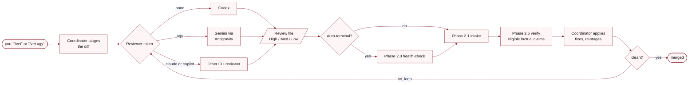

# implement-review

Structured cross-model review loop that sends staged changes to a reviewer agent and iterates until findings are resolved. Content-type-aware lenses apply established review criteria from the Google / Microsoft engineering playbooks (code), NeurIPS / ICLR / ICML / ACL guidelines (papers), and the NSF Merit Review / NIH Simplified Peer Review frameworks (proposals).

With `IMPLEMENT_REVIEW_DEFAULT_CHANNEL=auto`, use `/vet` for the default Codex reviewer or `/vet agy` for Gemini through Antigravity. Without that setting, write `/vet auto agy`. The Agy backend defaults to the newest model of the registry's Agy reviewer family that the account lists (see [Antigravity models](https://antigravity.google/docs/models/)), at the registry's effort tier. An account that lists no member of that family falls back to the registry's fallback family. `gemini` and `antigravity` remain accepted aliases.

The Claude, Codex, and Agy reviewers take their model and effort from the registry, `user/agent-models.json` (see the `agent-models` skill). A review follows the interactive session's effort by default; the dispatchers keep no floor of their own, and a Claude review no longer passes a fixed top effort. Each of their dispatchers writes `<state-dir>/review-model` with the model and effort it requested next to what the CLI reported, and prints `MODEL-MISMATCH` when a reported value differs or `MODEL-UNVERIFIED` when the run could not be read back in full. The Copilot dispatcher uses Copilot's own defaults and writes no such record. Bootstrap runs `agent_models.py sync` to write the interactive Codex and Agy values into their own configs (`AGENT_MODELS_SYNC=off` skips it).

Reviewer choice does not reduce validation capability. Codex, Agy, Copilot, and headless Claude all run unattended with access to shell commands, tests, experiments, and necessary network verification. Agy and Claude use disposable staged snapshots when export succeeds, so verification may create generated artifacts without polluting the source checkout. The shared review contract still forbids commit, push, publication, external-system mutation, and destructive cleanup.

| Invocation | Reviewer | Review file |
|---|---|---|
| `/vet` | Codex | `Review-Codex.md` |
| `/vet agy` | The newest model of the registry's Agy reviewer family, through Antigravity | `Review-Antigravity.md` |
| `/vet copilot` | GitHub Copilot CLI | `Review-GitHub-Copilot.md` |
| `/vet claude` | Headless Claude Code, subject to the self-review guard | `Review-Claude-Code.md` |

Phase 2.5 covers checkable High-priority findings, checkable Medium findings from Auto-terminal embedded-diff retry, and user-requested checks on Medium / Low findings.

See [Example reviews](references/example-reviews/example-code-phased.md) for complete worked examples across code, paper, and proposal lenses.


